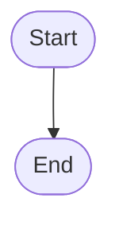

# Process Flow Model

## Document Control

- Product/system:
- Initiative:
- Model version:
- Status:
- Source use-case catalog:
- Source FR catalog:
- Owner:
- Date:
- Applicable `AGENTS.md`:

## Flow Inventory

| Flow ID | Title | Scope / Question | Status |
|---|---|---|---|
| PF-001 | | | |

## Process Flow

### PF-001 — [Title]

- Status:
- Quality status: READY / READY_WITH_OPEN_QUESTIONS / REQUIRES_BRANCH_RULE / REQUIRES_RETRY_POLICY / REQUIRES_APPROVAL_POLICY / REQUIRES_REQUIREMENT_CLARIFICATION / CONFLICTED
- Process question:
- Trigger / Start:
- Success end:
- Other terminal outcomes:
- Participants / owners:
- Source use case(s):
- Source FR(s):
- Business rules:
- Relevant NFR/QA:
- Open questions:

### Activities

| ID | Activity | Owner | Source |
|---|---|---|---|
| A1 | | | |

### Decisions

| ID | Decision question | Branches | Rule/source | Gap |
|---|---|---|---|---|
| D1 | | | | |

### Loops / Retries

| ID | Entry | Continue condition | Exit condition | Policy/source | Gap |
|---|---|---|---|---|---|
| L1 | | | | | |

### Manual / Automated Handoffs

| From | To | Handoff | Condition |
|---|---|---|---|
| | | | |

### Fallback / Failure Paths

| ID | Trigger | Path | Terminal/rejoin outcome | Source |
|---|---|---|---|---|
| F1 | | | | |

### Diagram Source

## Swimlane Decision

- Swimlanes useful: yes/no
- Reason:
- Lanes:

## Coverage Matrix

| Use Case / FR | Flow | Coverage |
|---|---|---|
| | | FLOW_COVERED / PARTIALLY_COVERED / NO_PROCESS_FLOW_NEEDED / MISSING_FLOW / BLOCKED_BY_DECISION |

## Branch Completeness Audit

| Decision | Expected domain outcomes | Represented | Missing |
|---|---|---|---|
| | | | |

## Reachability / Dead-End Audit

- Unreachable nodes:
- Orphan nodes:
- Dangling branches:
- Implicit terminal nodes:
- Invalid joins:

## Loop Safety Audit

- Loops without explicit exit:
- Retry terminal outcome missing:
- Approval/rework loops unresolved:

## Requirement Conflict Audit

| Flow item | Requirement/rule | Conflict | Status |
|---|---|---|---|
| | | | FLOW_REQUIREMENT_CONFLICT / RESOLVED |

## Modeling Handoffs

### State Machine Candidates

| Process area | Stable states/transitions implied | Reason |
|---|---|---|
| | | |

### Sequence Diagram Candidates

| Process area | Participants/timing concern | Reason |
|---|---|---|
| | | |

## Leakage Audit

- UI detail removed:
- Architecture detail removed:
- Code control-flow detail removed:
- Sequence-message detail removed:

## Final Decision

- Decision: PROCESS_FLOW_MODEL_READY / PROCESS_FLOW_MODEL_READY_WITH_OPEN_QUESTIONS / PROCESS_FLOW_MODEL_REQUIRES_BRANCH_RULE / PROCESS_FLOW_MODEL_REQUIRES_RETRY_POLICY / PROCESS_FLOW_MODEL_REQUIRES_APPROVAL_POLICY / PROCESS_FLOW_MODEL_REQUIRES_REQUIREMENT_CLARIFICATION / PROCESS_FLOW_MODEL_CONFLICTED / BLOCKED
- Blocking branch rules:
- Retry policy gaps:
- Approval policy gaps:
- Requirement conflicts:
- Ready for `modeling-state-machines`:
