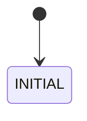

# State Machine Model

## Document Control

- Product/system:
- Initiative:
- Model version:
- Status:
- Source use-case catalog:
- Source process-flow model:
- Source FR catalog:
- Owner:
- Date:
- Applicable `AGENTS.md`:

## State Machine Inventory

| Machine ID | Lifecycle subject | Status |
|---|---|---|
| SM-001 | | |

## State Machine

### SM-001 — [Lifecycle Subject]

- Status:
- Quality status: READY / READY_WITH_OPEN_QUESTIONS / REQUIRES_STATE_DEFINITION / REQUIRES_TRANSITION_RULE / REQUIRES_CONCURRENCY_POLICY / REQUIRES_EVENT_ORDERING_POLICY / CONFLICTED
- Initial state:
- Terminal states:
- Source use cases:
- Source FRs:
- Business rules:
- Relevant NFR/QA:
- Open questions:

## State Catalog

| State | Meaning | Stable? | Terminal? | Invariants | Source |
|---|---|---|---|---|---|
| | | yes/no | yes/no | | |

## Event Catalog

| Event | Meaning | Source/actor | Source |
|---|---|---|---|
| | | | |

## Guard Catalog

| Guard | Condition | Rule/source |
|---|---|---|
| | | |

## Transition Table

| ID | Current state | Event | Guard | Next state | Effect | Source |
|---|---|---|---|---|---|---|
| TR-001 | | | | | | |

## Illegal / Unspecified Transitions

| Current state | Event | Expected semantic | Status / Gap |
|---|---|---|---|
| | | reject / no-op / idempotent / not-applicable / TBD | ILLEGAL_TRANSITION_BEHAVIOR_REQUIRED / defined |

## Allowed Capabilities by State

| State | Capability / Use Case | Allowed | Rule/source |
|---|---|---|---|
| | | yes/no/conditional | |

## Cancellation / Reopen / Rollback

| Operation | Allowed from states | Guard | Next state/effect | Source / Gap |
|---|---|---|---|---|
| cancel | | | | |
| reopen | | | | |
| rollback/compensate | | | | |

## Concurrency / Race Analysis

| Scenario | Concurrent events | Current state | Required semantic outcome | Gap |
|---|---|---|---|---|
| | | | | CONCURRENCY_POLICY_REQUIRED / defined |

## External Event Ordering / Idempotency

| Event | Duplicate behavior | Out-of-order behavior | Late behavior | Source / Gap |
|---|---|---|---|---|
| | | | | |

## External Provider State Mapping

| Provider state | Internal state/event | Mapping confidence | Notes |
|---|---|---|---|
| | | | |

## Diagram Source

## Reachability Audit

- Unreachable states:
- Orphan states:
- Dead nonterminal states:
- Unreachable terminal states:
- Missing creation/initial transition:

## Determinism / Guard Audit

- Same state+event with overlapping guards:
- Missing guard cases:
- Contradictory next states:
- Nondeterministic transitions:

## State Explosion Audit

- Attribute combinations incorrectly modeled as states:
- Composite states justified:
- Parallel regions justified:
- Machine split required:

## Traceability Matrix

| State/Transition | FR | Use Case | Process Flow | Business Rule | NFR/QA |
|---|---|---|---|---|---|
| | | | | | |

## Modeling Handoffs

### Sequence Diagram Candidates

| Transition/use case | Participants/timing/event concern |
|---|---|
| | |

### Data Model Candidates

- Lifecycle status:
- Transition timestamps/history:
- Ownership:
- Audit/history:
- Provider mapping:

## Gap Ledger

| ID | Area | Gap | Type | Owner |
|---|---|---|---|---|
| | | | STATE_DEFINITION_REQUIRED / TRANSITION_EVENT_REQUIRED / TRANSITION_GUARD_REQUIRED / TRANSITION_OUTCOME_REQUIRED / ILLEGAL_TRANSITION_BEHAVIOR_REQUIRED / CONCURRENCY_POLICY_REQUIRED / EVENT_ORDERING_POLICY_REQUIRED | |

## Final Decision

- Decision: STATE_MACHINE_MODEL_READY / STATE_MACHINE_MODEL_READY_WITH_OPEN_QUESTIONS / STATE_MACHINE_MODEL_REQUIRES_STATE_DEFINITION / STATE_MACHINE_MODEL_REQUIRES_TRANSITION_RULE / STATE_MACHINE_MODEL_REQUIRES_CONCURRENCY_POLICY / STATE_MACHINE_MODEL_REQUIRES_EVENT_ORDERING_POLICY / STATE_MACHINE_MODEL_CONFLICTED / BLOCKED
- Blocking state definitions:
- Blocking transition rules:
- Concurrency gaps:
- Ordering/idempotency gaps:
- Ready for architecture/modeling downstream:
